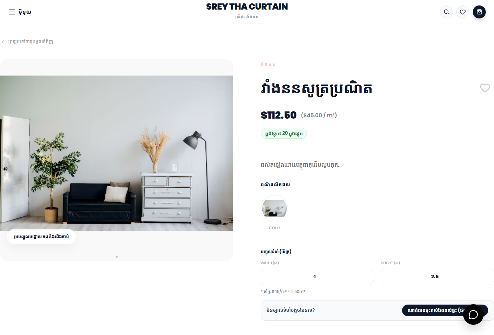
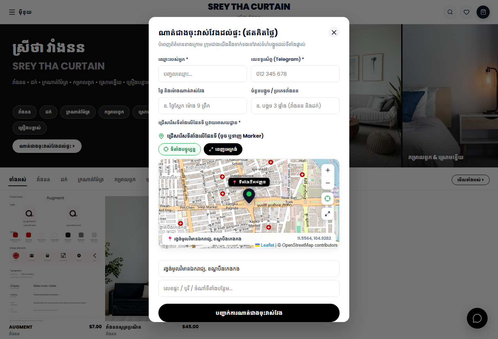
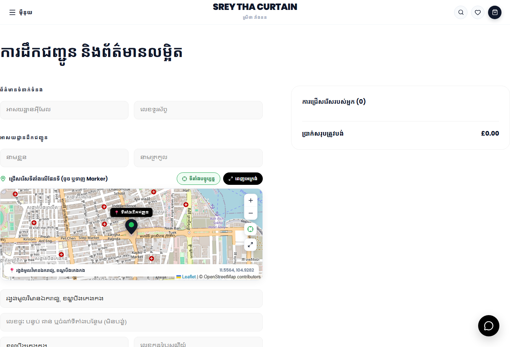
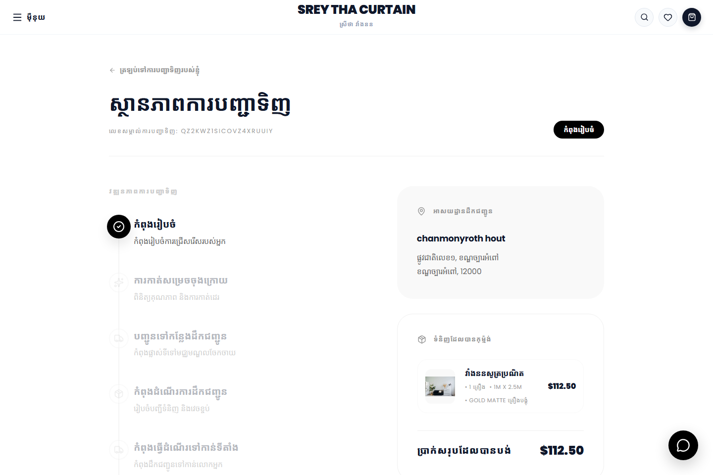
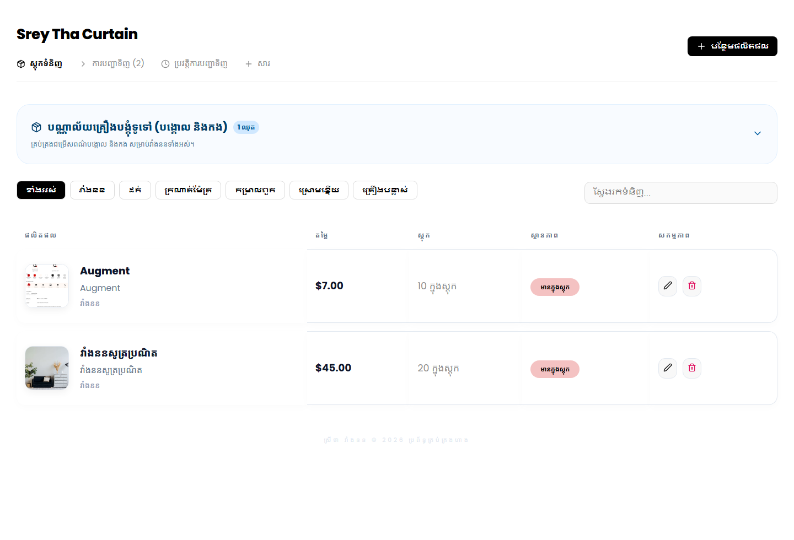
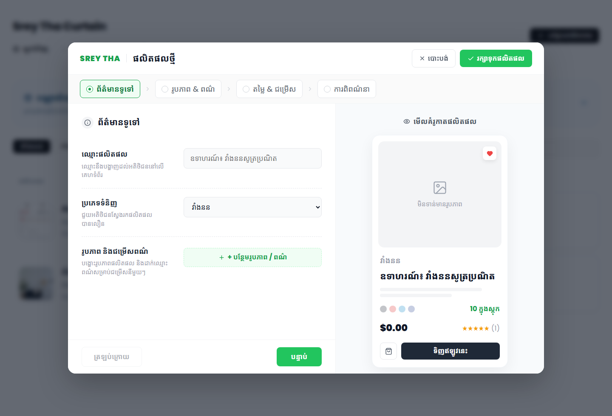
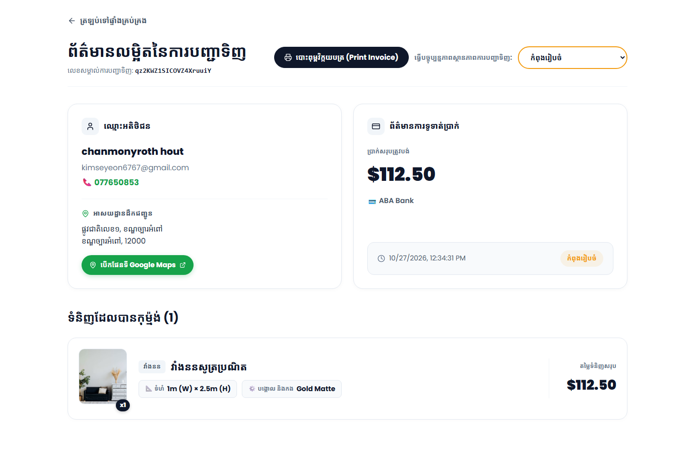

# Srey Tha Curtain (ស្រីថា វាំងនន) — E-Commerce & Admin Platform

An e-commerce website and admin dashboard for a custom curtain and home decor shop in Cambodia, integrated with a **Telegram Bot** for instant order and measurement booking alerts. This project is built with **React (Vite)** for the frontend, **Node.js & Express** for the backend, **Firebase Cloud Firestore** for the database, **Cloudinary** for image storage, and the **Telegram Bot API** for real-time notifications.

---

## Tech Stack

### Frontend (`ecommerce-frontend` & `admin-dashboard`)
- **React 18 (Vite)** — Component-based storefront and administrative dashboard.
- **React Router v6** — Client-side routing for product catalog, customizer, checkout, and order tracking.
- **Leaflet & OpenStreetMap** — Interactive draggable map pin-picker and reverse geocoding for delivery addresses and in-home measurement appointments.
- **Axios** — REST API client communication.
- **Lucide React & Custom Editorial CSS** — Responsive, full-screen minimalist interface with Khmer (`Noto Sans Khmer`, `Kdam Thmor Pro`) and English (`Poppins`) typography.

### Backend (`backend`)
- **Node.js & Express.js** — RESTful API managing products, custom hardware options, stock deduction, orders, live chat, and measurement bookings.
- **Firebase Admin SDK (Cloud Firestore)** — NoSQL cloud database storing products, inventory counts, hardware library, customer orders, and measurement requests.
- **Cloudinary & Multer** — Cloud media storage and multi-image upload pipeline for product variants and curtain hardware (poles & rings).
- **Telegram Bot API** — Real-time HTML-formatted notifications sent directly to the shop owner's Telegram with order specifications, customer contact info, and clickable Google Maps navigation links.

---

## Key Features

1. **Custom Curtain & Drapery Calculator**
   - Dynamic area pricing (`Width × Height × Price/m²`) for **Curtains (`វាំងនន`)** and **Valances (`ដក់`)**, per-meter pricing for **Fabrics (`ក្រណាត់ម៉ែត្រ`)**, and unit/size-based pricing for **Bed Sheets (`កម្រាលពូក`)**, **Pillow Cases (`ស្រោមខ្នើយ`)**, and **Accessories (`គ្រឿងបន្លាស់`)**.
   - Interactive hardware selector for matching curtain poles and rings (`បង្គោល និងកង`).
2. **Free Home Measurement Booking (`ណាត់ជាងចុះវាស់វែងដល់ផ្ទះ`)**
   - Customers who are unsure of their window dimensions can schedule a free technician visit with their phone number, preferred date/time, window notes, and an interactive Google Maps / OpenStreetMap location pin.
3. **Interactive Map Pinning at Checkout**
   - Customers can drag the map marker or use GPS to pinpoint their exact house location, generating a direct Google Maps navigation link for the delivery driver.
4. **Automated Stock Management & Discount Pricing**
   - Automatically deducts stock quantities in Firestore when an order is placed, restores stock if an order is cancelled, prevents ordering out-of-stock items, and supports crossed-out original prices (`originalPrice`) with percentage discount badges.
5. **Instant Telegram Bot Alerts**
   - Sends structured notifications to Telegram when a new order is placed, when a customer books a home measurement, when a customer requests an installer (`ស្នើសុំជាងចុះតម្លើង`), or when an order is cancelled.
6. **Admin Dashboard & Printable Tailor Invoices**
   - Full CRUD product wizard with live card preview, global hardware library manager, order fulfillment pipeline, and a one-click **Print Invoice & Tailor Sheet (`បោះពុម្ពវិក្កយបត្រ`)** generator formatted for A4 printing.

---

## UI Screenshots

### 1. Storefront — Home Page & Product Type Filter
Full-width editorial layout with interactive product type tabs (`វាំងនន`, `ដក់`, `ក្រណាត់ម៉ែត្រ`, `កម្រាលពូក`, `ស្រោមខ្នើយ`, `គ្រឿងបន្លាស់`) and a 5-column product grid.


---

### 2. Storefront — Custom Curtain Product Detail & Calculator
Real-time custom dimension calculator (`Width × Height`), stock availability badge, color variant gallery, hardware selector, and free measurement booking trigger.



---

### 3. Storefront — Free Home Measurement Booking Modal
Allows customers to book an in-home window measurement with interactive map pinning and instant Telegram notification.



---

### 4. Storefront — Checkout with Interactive Delivery Map
Customer checkout form featuring an interactive Leaflet map pin-picker that automatically resolves street addresses and attaches Google Maps coordinates.



---

### 5. Storefront — Order Status & Real-Time Tracking
Step-by-step fulfillment progress tracker (`កំពុងរៀបចំ` → `ការកាត់សម្រេចចុងក្រោយ` → `ដឹកជញ្ជូនដល់ទីតាំង`) with one-click installer request and order cancellation actions.



---

### 6. Admin Dashboard — Inventory & Stock Management
Centralized inventory table displaying product thumbnails, Khmer/English titles, sale & original prices, live stock counts, and global hardware sets.



---

### 7. Admin Dashboard — 4-Step Product Creation Wizard & Live Preview
Interactive product editor with multi-photo upload, color tagging, discount pricing, hardware synchronization, and a real-time storefront card preview.



---

### 8. Admin Dashboard — Active Orders Queue
Order management table displaying customer details, item specifications, payment method, and status badges.


---

### 9. Admin Dashboard — Order Details & Printable Tailor Invoice
Detailed order breakdown with direct Google Maps navigation link, status updater, item dimension chips, and one-click printable A4 invoice/tailor sheet.



---

## Project Structure

```text
curtain-shop/
├── ecommerce-frontend/     # Customer-facing React (Vite) storefront (Port 5173)
├── admin-dashboard/        # Shop owner React (Vite) management panel (Port 5174)
├── backend/                # Node.js + Express REST API & Telegram Bot integration (Port 5000)
│   ├── config/             # Firebase Firestore & Cloudinary configuration
│   ├── routes/             # Product, Order, Hardware, and Chat API endpoints
│   └── utils/              # Telegram Bot HTML notification formatters
└── docs/screenshots/       # Application UI screenshots
```

---

## Local Development Setup

### 1. Prerequisites
- **Node.js** (v18+ recommended)
- A **Firebase** project with Cloud Firestore enabled (`serviceAccountKey.json` placed in `backend/serviceAccountKey.json`)
- A **Cloudinary** account for image uploads
- A **Telegram Bot Token** & **Chat ID** for order notifications

### 2. Backend Configuration
Create a `.env` file inside the `backend/` directory (never commit `.env` or `serviceAccountKey.json`):

```env
PORT=5000
CLOUDINARY_CLOUD_NAME=your_cloud_name
CLOUDINARY_API_KEY=your_api_key
CLOUDINARY_API_SECRET=your_api_secret
TELEGRAM_BOT_TOKEN=your_telegram_bot_token
TELEGRAM_CHAT_ID=your_telegram_chat_id
```

Install dependencies and start the backend server:

```bash
cd backend
npm install
npm start
```

### 3. Start the Customer Storefront
```bash
cd ecommerce-frontend
npm install
npm run dev
```

### 4. Start the Admin Dashboard
```bash
cd admin-dashboard
npm install
npm run dev
```
